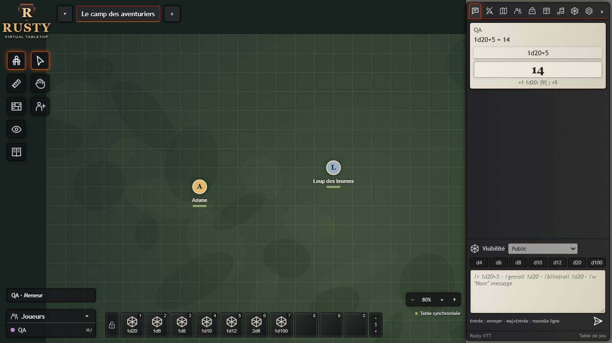

# Rusty VTT

Table de jeu de rôle virtuelle indépendante, en français. Le serveur, les dés, les permissions, les actions de jeu et la sauvegarde sont en **Rust**. Le navigateur utilise HTML/CSS et JavaScript pour afficher le canvas et transmettre les interactions. Aucun service hébergé ni compte Foundry n'est nécessaire.

## Aperçu de l’interface



La table de jeu avec ses pions, ses outils de carte, le chat et la barre de raccourcis.

## Démarrer

1. Installer Rust stable puis lancer **cargo run --locked** dans ce dossier.
2. Ouvrir **http://127.0.0.1:3000** dans un navigateur.
3. Choisir un nom et saisir le secret MJ affiché dans la console au démarrage, ou votre nom et votre secret joueur configurés par le meneur. Aucun accès joueur anonyme n'est accepté.
4. Arrêter le serveur avec **Ctrl+C** dans sa console.

Le serveur intègre l’interface à la compilation. Cette édition publique distribue les sources ; les sauvegardes locales sont exclues.

## Jouer

- **Carte** : glisser un pion pour le déplacer, molette pour zoomer, outil déplacement pour explorer, bouton cible pour cadrer la scène. Les déplacements s'alignent sur la grille.
- **Pions** : outil pion puis clic sur la carte pour créer un personnage représenté par un marqueur. Double-clic sur un pion pour modifier ses PV ou le cacher. Le propriétaire est le nom exact du joueur ; un propriétaire vide signifie un pion partagé.
- **Scènes** : bouton `+` à côté des onglets. Le MJ active une scène pour tous les joueurs. Dans Monde, régler sa grille et son image de fond (URL HTTP(S) ou image `data:`). Sans image, un fond procédural original est affiché.
- **Mesure** : glisser avec la règle pour obtenir une distance en cases.
- **Murs et portes** : tracer des segments, puis régler leurs blocages et leur état dans Paramètres → Scène : murs, portes et vision. Les collisions et la vision sont activables par scène ; le MJ ignore les collisions. L'éclairage reste à développer.
- **Brouillard manuel** : glisser un rectangle pour masquer une zone ; Monde permet de tout dissiper. Les pions et notes dont le centre est couvert sont retirés des données envoyées aux joueurs. L'image de fond complète reste accessible au navigateur : ce masque ne protège pas les détails secrets d'une image.
- **Notes de carte** : créer une note avec l'outil plume puis double-cliquer près de son marqueur pour la lire.
- **Personnages** : fiches génériques avec PV, défense, propriétaire et notes de capacités/équipement. Chaque joueur peut modifier ses fiches et les fiches partagées. Les notes des autres fiches sont filtrées côté serveur. Les fiches et les pions sont actuellement deux documents distincts : leurs PV ne sont pas liés automatiquement.
- **Dés et chat** : boutons d4 à d100 ou `/r 2d6+3`. Le serveur tire et conserve les résultats, avec détail des dés. Les sommes et soustractions sont prises en charge, jusqu'à 100 dés. Historique limité à 500 messages.
- **Combat** : bouton Initiative depuis une fiche, tri par initiative tirée, tour suivant et compteur de rounds. États descriptifs avec durée, pause et expiration au nouveau round pour les participants. Aucun calcul générique automatique de dégâts.
- **Journal** : pages partagées ou réservées au MJ. **Objets** : catalogue descriptif.
- **Ambiance** : ajouter une URL audio ; chaque navigateur dispose de son lecteur local avec boucle. La lecture audio n'est pas synchronisée entre participants.
- **Monde** : exporter et réimporter les sauvegardes JSON de Rusty VTT. Ce format n'est pas celui de Foundry.

## Sauvegardes et réseau

Chaque action acceptée est sauvegardée dans `data/world.json` avant notification aux clients. Écriture temporaire puis remplacement du fichier ; une écriture échouée laisse l'état en mémoire inchangé. Le serveur refuse de démarrer sur un fichier corrompu plutôt que d'écraser votre monde. Exporter des copies avant une importation : importer remplace le monde courant.

Les sessions expirent après huit heures et disparaissent au redémarrage. Cliquer sur son identité déconnecte la session et efface son cookie. Chaque joueur doit disposer d'un secret individuel configuré par l'hôte ; les noms configurés sont les identifiants stables utilisés par les propriétaires existants. Conserver exactement ces noms lors de la configuration d'une campagne existante. Les secrets ne figurent jamais dans les exports du monde. Pour retirer un accès ou changer un secret, modifier la configuration et redémarrer le serveur : toutes les anciennes sessions sont alors invalidées.

Configuration PowerShell avant de lancer :

```powershell
$env:RUSTY_GM_PASSWORD = [guid]::NewGuid().ToString('N')
$aliceSecret = [guid]::NewGuid().ToString('N')
$bobSecret = [guid]::NewGuid().ToString('N')
$env:RUSTY_PLAYERS_JSON = @{ Alice = $aliceSecret; Bob = $bobSecret } | ConvertTo-Json -Compress
$env:RUSTY_BIND = '127.0.0.1:3000'
$env:RUSTY_DATA = 'data/world.json'
$env:RUSTY_HTTPS = '0' # Développement local uniquement
# Communiquer séparément chaque secret au joueur concerné ; conserver les secrets
# dans un emplacement privé pour les réutiliser au prochain lancement.
cargo run --locked
```

Un secret configuré doit avoir au moins 16 octets ; utiliser des valeurs aléatoires distinctes pour le MJ et chaque joueur. Sans `RUSTY_GM_PASSWORD`, un secret MJ aléatoire est généré et affiché pour cette exécution. Sans `RUSTY_PLAYERS_JSON`, aucun compte joueur n'est activé. La configuration est chargée au démarrage ; ne pas placer ces valeurs dans Git.

L'écoute HTTP est limitée aux adresses de boucle locale (`127.0.0.1` ou `::1`). Les anciennes configurations `0.0.0.0` sont refusées. Pour accéder à la table depuis une autre machine, installer un proxy HTTPS sur la machine hôte et définir `RUSTY_HTTPS=1`. Le proxy doit terminer TLS avec un certificat approuvé, rediriger HTTP vers HTTPS et remplacer `X-Forwarded-Proto` par `https` sur les requêtes HTTPS vers le serveur local. Dans ce mode, les API refusent les requêtes sans cette indication, les cookies portent `Secure` et les réponses HTTPS portent HSTS. Cette option ne crée ni certificat ni proxy.

Exemple de configuration Caddy (remplacer le domaine par celui de votre installation et le faire pointer vers votre hôte) :

```caddyfile
table.example.org {
    reverse_proxy 127.0.0.1:3000 {
        header_up X-Forwarded-Proto https
    }
}
```

Le backend reste sur la boucle locale ; seul le proxy est accessible aux participants. Le projet ne modifie pas le pare-feu ni le routeur. Pour plusieurs campagnes, lancer des instances avec ports et chemins `RUSTY_DATA` différents.

Limites de protection : 30 tentatives de connexion par minute et par IP source, 8 sessions par nom, 256 sessions au total, 120 mutations par minute et par session, 2 flux d'événements par session et 32 au total. Derrière un proxy local, le quota de connexion est partagé par la table : le serveur utilise l'IP de la connexion réelle et ne fait pas confiance à `X-Forwarded-For`. Le monde sauvegardé est limité à 32 Mio. Une limite dépassée refuse la requête ; les quotas ne remplacent pas la maîtrise de l'accès au proxy.

## Développement et vérification

Prérequis pour recompiler : Rust stable avec la cible Windows MSVC et ses outils de compilation. Les dépendances exactes sont figées dans `Cargo.lock`.

```powershell
cargo test --locked
cargo run --locked
# Compilation optimisée optionnelle : cargo build --release --locked
# Test HTTP complet, nécessite Node 24+ :
cargo build --locked
node tests/smoke.mjs target/debug/rusty-vtt.exe
```

Le scénario HTTP lance son propre serveur sur le port 3017 avec des données temporaires : authentification, permissions, dés, scènes/documents, combat, brouillard, SSE, import/export et restauration après redémarrage. Les tests ne touchent pas votre campagne.

## Architecture et périmètre

`src/main.rs` : serveur Axum/Tokio, stockage JSON, projection MJ/joueur, générateur de dés, opérations de documents et notifications SSE. `web/` : interface intégrée dans le binaire à la compilation. Le serveur sérialise les mutations d'un monde avec un verrou ; les clients rechargent leur projection après chaque notification. C'est adapté à une petite table, sans journal transactionnel de base de données ni protocole de synchronisation de grandes campagnes.

Cette version fournit le socle d'une partie, l’adaptation 5e et les fonctions avancées décrites plus bas. Elle n'atteint pas la parité avec Foundry : éclairage dynamique, exploration persistante, macros extensibles, import complet de mondes Foundry, comptes joueurs sécurisés, audio synchronisé, vidéo/voix et bibliothèque de campagnes restent à développer. La vision limitée et les collisions sont activables ; le brouillard rectangulaire reste manuel.

## Interface classique (mise à jour)

Le bureau reprend maintenant la disposition de Foundry 12 : carte sur toute la hauteur, navigation des scènes en haut, catégories et outils en deux colonnes à gauche, panneau compact à droite, messages sur parchemin, encadré du joueur en bas à gauche et barre de raccourcis en bas. Les icônes SVG, styles et textures CSS sont indépendants des fichiers de Foundry.

- Les catégories de gauche affichent leurs outils secondaires.
- Le chevron du panneau latéral le replie ; cliquer sur un onglet le développe.
- La recherche filtre les documents du panneau courant.
- Les fiches sont des fenêtres flottantes : déplacer leur barre de titre et utiliser le coin inférieur droit pour les redimensionner.
- Les touches 1 à 9 et 0 lancent les dés des dix emplacements. Clic droit pour personnaliser un emplacement, clic sur un emplacement vide pour le créer. Cinq pages sont disponibles ; le cadenas protège la configuration. Les raccourcis sont enregistrés dans le navigateur, pas dans le monde.
- L'encadré Joueurs montre actuellement votre session, pas la présence des autres clients.

La reproduction porte sur l'organisation et l'apparence des fonctions disponibles, pas sur les fonctions Foundry encore absentes du moteur Rusty.

## Créateur de personnage 5e en français

Activer **Créateur de personnage 5e — Français** dans **Paramètres → Gérer les modules**. Création guidée, brouillons persistants, caractéristiques, origines, maîtrises, sorts français, équipement, fiche et progression sont adaptés au moteur Rust. Le catalogue utilise le SRD français 5.2.1 : 12 classes, 9 espèces, 4 historiques et 339 sorts. Cette adaptation ne couvre pas toutes les automatisations Foundry. Utilisation, provenance et limites : [docs/DND5E_BUILDER_FR.md](docs/DND5E_BUILDER_FR.md).

## Fonctions avancées

**Paramètres → Scène : murs, portes et vision** : collisions serveur, portes verrouillables et portée de vision des pions arrêtée par les murs. Les options sont désactivées par défaut dans les anciennes scènes. Le fond de carte complet reste téléchargé : son masque ne protège pas les détails de l'image.

Le chat propose jets MJ, aveugles et personnels, ainsi que les murmures (`/gmroll`, `/blindroll`, `/selfroll`, `/w "Nom" message`). Les noms sont authentifiés par les secrets individuels configurés par l'hôte. Les combattants masqués par le brouillard, la vision ou leur option cachée sont retirés de l'ordre de combat envoyé aux joueurs ; le tour affiché est recalculé. **Personnages/Rencontre → États et durées** ajoute les états temporisés descriptifs, sans modifier automatiquement les caractéristiques.

Test HTTP isolé : `node tests/advanced.mjs target/debug/rusty-vtt.exe`.
